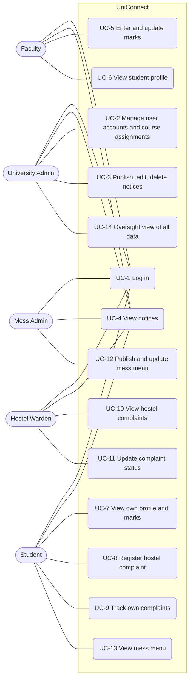

# Use Cases (MVP)

Version: 1.0
Date: 17 November 2026
Owner: Harsh (System Analyst & Software Architect)

Covers the MVP only (FR-1 to FR-19 in SRS v1.1). Features marked "Later" in the SRS are not modelled here.

## 1. Use case diagram

FR-18 (access control) is not a separate use case. It applies to every use case and is defined in `permission-matrix.md`.

## 2. Use case descriptions

| ID | Use case | Actor | Short description | SRS |
|---|---|---|---|---|
| UC-1 | Log in | All roles | User enters username and password. System checks them and opens the dashboard for the user's role. No self-registration. | FR-1, FR-2, FR-4, NFR-1 |
| UC-2 | Manage user accounts and course assignments | University Admin | Admin creates, edits and deactivates accounts, and links faculty and students to courses. | FR-3, FR-31 |
| UC-3 | Publish, edit, delete notices | University Admin | Admin writes a notice, edits it, or deletes it. | FR-6 |
| UC-4 | View notices | All roles | Logged-in user sees all notices in one list, newest first. | FR-7 |
| UC-5 | Enter and update marks | Faculty | Faculty picks one of their courses and a student in it, enters or changes marks and grade. Each change is written to the audit log. | FR-8, FR-11 |
| UC-6 | View student profile | Faculty | Faculty opens the profile of a student in one of their courses. | FR-9 |
| UC-7 | View own profile and marks | Student | Student sees only their own profile, marks and grades. | FR-10, NFR-4 |
| UC-8 | Register hostel complaint | Student | Student submits a complaint with title and description. Status starts as Pending. | FR-12 |
| UC-9 | Track own complaints | Student | Student sees the status (Pending, In Progress, Resolved) of their own complaints. | FR-13 |
| UC-10 | View hostel complaints | Hostel Warden | Warden sees all complaints of their hostel. | FR-14 |
| UC-11 | Update complaint status | Hostel Warden | Warden moves a complaint Pending to In Progress to Resolved. | FR-15 |
| UC-12 | Publish and update mess menu | Mess Admin | Mess admin sets the menu for each day and meal, and edits it. | FR-16 |
| UC-13 | View mess menu | Student | Student sees the daily and weekly menu. | FR-17 |
| UC-14 | Oversight view of all data | University Admin | Admin can view all student, faculty, hostel and mess data. | FR-19 |

## 3. Coverage check (every MVP requirement is modelled)

| FR | Use case | Permission matrix row | Data (see data-dictionary.md) |
|---|---|---|---|
| FR-1, FR-2 | UC-1 | Dashboards | User |
| FR-3 | UC-2 | User accounts | User, Student, Faculty |
| FR-4 | UC-1 | User accounts | User |
| FR-6 | UC-3 | University notices | Notice |
| FR-7 | UC-4 | University notices | Notice |
| FR-8 | UC-5 | Marks and grades | Marks, Enrollment, CourseFaculty |
| FR-9 | UC-6 | Student profile | Student |
| FR-10 | UC-7 | Student profile, Marks and grades | Student, Marks |
| FR-11 | UC-5 | Mark audit log | AuditLog |
| FR-12 | UC-8 | Hostel complaints | Complaint |
| FR-13 | UC-9 | Hostel complaints | Complaint |
| FR-14 | UC-10 | Hostel complaints | Complaint, Hostel |
| FR-15 | UC-11 | Hostel complaints | Complaint |
| FR-16 | UC-12 | Mess menu | MenuItem, MealSlot |
| FR-17 | UC-13 | Mess menu | MenuItem |
| FR-18 | All | Whole matrix | User.role |
| FR-19 | UC-14 | "Univ. Admin" column | All |
| FR-31 | UC-2 | Course assignments | Course, CourseFaculty, Enrollment |

## 4. Change log

| Version | Date | Change | Author |
|---|---|---|---|
| 0.1 | 17 Nov 2026 | Draft of MVP use cases | Harsh (draft) |
| 1.0 | 17 Nov 2026 | Reviewed and confirmed by the team | Hansika |