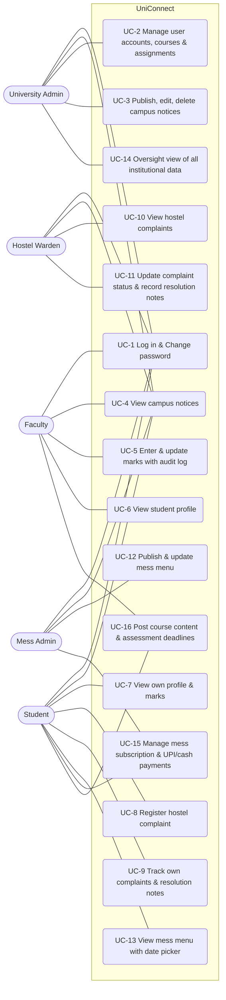

# Use Cases (MVP)

Version: 1.1
Date: 19 November 2026
Owner: Harsh (System Analyst & Software Architect), updated with Development Team

Covers the MVP (SRS v1.3). Features marked "Later" in the SRS are not modelled here.

## 1. Use case diagram

FR-18 (access control) applies to every use case and is defined in `permission-matrix.md`.

## 2. Use case descriptions

| ID | Use case | Actor | Short description | SRS |
|---|---|---|---|---|
| UC-1 | Log in & Change password | All roles | User logs in with username and password. After login, user can change their own password. No self-registration. | FR-1, FR-2, FR-4, FR-35, NFR-1 |
| UC-2 | Manage user accounts, courses & assignments | University Admin | Admin creates, edits, deactivates and reactivates accounts (`enrollment_id`, `custom_hostel_id`), creates courses, and assigns faculty/students. | FR-3, FR-31, FR-32 |
| UC-3 | Publish, edit, delete notices | University Admin | Admin writes a notice, edits it, or deletes it with confirmation. | FR-6 |
| UC-4 | View notices | All roles | Logged-in user sees all notices in one list, newest first, expandable to read full text. | FR-7 |
| UC-5 | Enter and update marks | Faculty | Faculty selects a course, sees roster status (`Graded` vs `Pending`), enters marks/grades. Changes written to audit log. | FR-8, FR-11 |
| UC-6 | View student profile | Faculty | Faculty opens the profile of an enrolled student in their course. Can navigate back to marks entry. | FR-9 |
| UC-7 | View own profile and marks | Student | Student sees only their own profile (identified by `enrollment_id`), enrolled subjects, marks and grades. | FR-10, NFR-4 |
| UC-8 | Register hostel complaint | Student | Resident student (with `custom_hostel_id`) submits complaint with title and description. Status starts as Pending. | FR-12 |
| UC-9 | Track own complaints | Student | Student sees status of their complaints and views warden resolution notes upon completion. | FR-13 |
| UC-10 | View hostel complaints | Hostel Warden | Warden sees all complaints matching their assigned hostel block prefix. | FR-14 |
| UC-11 | Update complaint status & notes | Hostel Warden | Warden views full complaint description modal, moves status forward (Pending -> In Progress -> Resolved), and records resolution notes. | FR-15 |
| UC-12 | Publish and update mess menu | Mess Admin | Mess admin publishes and updates Breakfast (8:30-10:30), Lunch (12:30-14:30), and Dinner (19:30-21:30) via Upsert. | FR-16 |
| UC-13 | View mess menu | Student | Student sees today's menu loaded by default and can select any date using a calendar date picker. | FR-17 |
| UC-14 | Oversight view of all data | University Admin | Admin views all student, faculty, hostel, mess, and audit log data. | FR-19 |
| UC-15 | Manage mess subscriptions & payments | Student, Mess Admin | Student opts in/out monthly, scans UPI QR, enters UTR, and uploads proof. Mess Admin verifies online payments and records manual cash receipts. | FR-33, FR-34 |
| UC-16 | Post course content & deadlines | Faculty, Student | Faculty posts lecture content, quizzes, lab evaluations, and assignment deadlines for their courses. Enrolled students view syllabus and dates. | FR-36 |

## 3. Coverage check (every MVP requirement is modelled)

| FR | Use case | Permission matrix row | Data (see data-dictionary.md) |
|---|---|---|---|
| FR-1, FR-2 | UC-1 | Dashboards | User |
| FR-3 | UC-2 | User accounts | User, Student, Faculty |
| FR-4 | UC-1 | User accounts | User |
| FR-6 | UC-3 | University notices | Notice |
| FR-7 | UC-4 | University notices | Notice |
| FR-8 | UC-5 | Marks and grades | Marks, Enrollment, CourseFaculty |
| FR-9 | UC-6 | Student profile | Student |
| FR-10 | UC-7 | Student profile, Marks and grades | Student, Marks |
| FR-11 | UC-5 | Mark audit log | AuditLog |
| FR-12 | UC-8 | Hostel complaints | Complaint, Student (`custom_hostel_id`) |
| FR-13 | UC-9 | Hostel complaints | Complaint |
| FR-14 | UC-10 | Hostel complaints | Complaint, Hostel |
| FR-15 | UC-11 | Hostel complaints | Complaint |
| FR-16 | UC-12 | Mess menu | MenuItem, MealSlot |
| FR-17 | UC-13 | Mess menu | MenuItem |
| FR-18 | All | Whole matrix | User.role |
| FR-19 | UC-14 | "Univ. Admin" column | All |
| FR-31 | UC-2 | Course assignments | Course, CourseFaculty, Enrollment |
| FR-32 | UC-2 | Course catalog | Course |
| FR-33 | UC-15 | Mess subscription | MessSubscription |
| FR-34 | UC-15 | Mess payment verification | MessSubscription |
| FR-35 | UC-1 | Change own password | User |
| FR-36 | UC-16 | Course content & deadlines | CoursePost |

## 4. Change log

| Version | Date | Change | Author |
|---|---|---|---|
| 0.1 | 17 Nov 2026 | Draft of MVP use cases | Harsh (draft) |
| 1.0 | 17 Nov 2026 | Reviewed and confirmed by the team | Hansika |
| 1.1 | 19 Nov 2026 | Added UC-15 (Mess subscriptions & cash), UC-16 (Course content & deadlines), password change & course creation updates | Team |
| 1.0 | 17 Nov 2026 | Reviewed and confirmed by the team | Hansika |