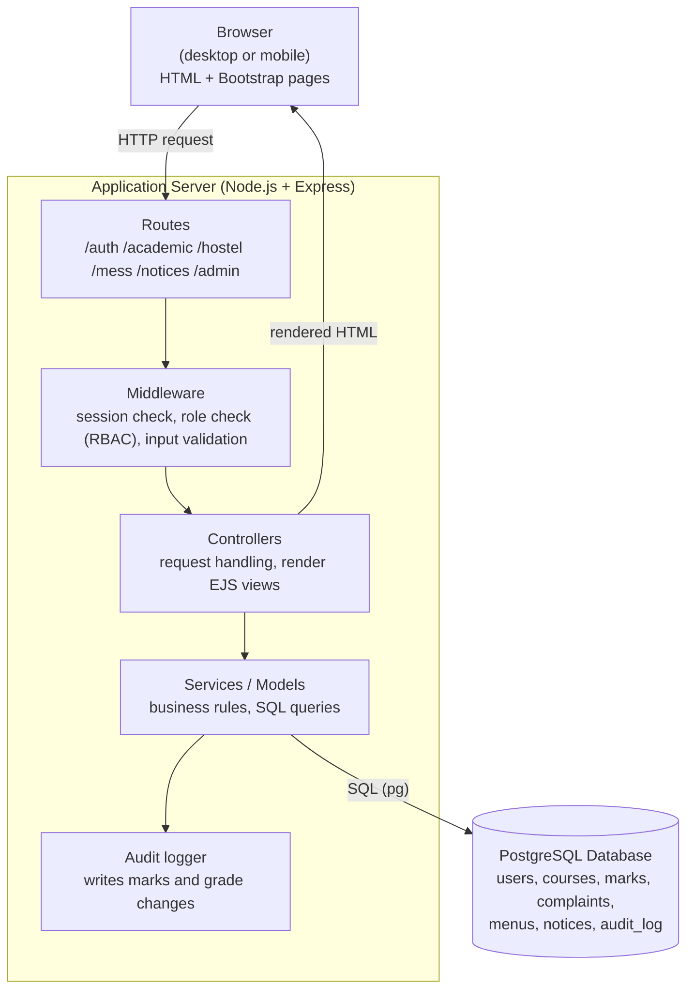

# UniConnect Architecture Diagram

**Version:** 1.1
**Date:** 18 November 2026
**Owner:** Harsh (System Analyst & Software Architect)

## 1. Overview

UniConnect is a three-tier web application: browser, application server, database. It is one deployable application (monolith) organised into modules by feature. Reasons for each choice are in `decision-record.md`.

## 2. System Architecture



## 3. Components

| Component | Responsibility |
|---|---|
| Browser | Shows role-specific pages; sends forms and requests. No access rules live here. |
| Routes | Map URLs to controllers, grouped by module. |
| Middleware | Checks the session is logged in, checks the role is allowed for the route, validates input. |
| Controllers | Take the request, call services, render the page or redirect. |
| Services / Models | Business rules (for example D-2: a warden sees only their hostel; D-4: faculty see only students in their own courses) and all database queries. |
| Audit logger | Writes who, what and when to `audit_log` for every marks or grade change, in the same database transaction as the change. |
| PostgreSQL | Stores all data. Schema follows `docs/design/er-diagram.md`. |

## 4. Module Structure

```
src/
  app.js              entry point, sessions, middleware setup
  config/             db connection, institution settings (hostels, departments, grading)
  middleware/         auth.js, requireRole.js, validate.js
  modules/
    auth/             login, logout
    academic/         profile, marks, courses
    hostel/           complaints, status tracking
    mess/             daily and weekly menu
    notices/          noticeboard
    admin/            account creation, course assignment
  views/              EJS templates per role
  public/             CSS, JS, images
```

## 5. Key Flows

- **Login:** browser posts credentials → auth module checks bcrypt hash → session created → redirect to the dashboard for that role.
- **Marks entry:** faculty posts marks → middleware confirms role is Faculty → service confirms the course is theirs → marks saved and audit row written in one transaction.
- **Complaint:** student posts complaint → saved as Pending → warden for that hostel updates status → student sees the new status.

Detailed sequences: `docs/design/sequence-diagrams.md`.

## 6. How This Meets the Non-Functional Requirements

| Concern | How the architecture handles it |
|---|---|
| Security | Passwords hashed with bcrypt; role checks run in server middleware on every route. |
| Privacy | Services filter data by role and ownership before returning it. |
| Auditability | Audit logger writes inside the marks transaction, so a change cannot happen without a log row. |
| Usability | Bootstrap responsive layout works on desktop and mobile browsers. |
| Maintainability | Code is split by feature module; README documents setup. |
| Adaptability | Hostels, departments and grading scheme are read from config/database, not hard-coded. |

## Change Log

| Version | Date | Change | Author |
|---|---|---|---|
| 1.0 | 18 Nov 2026 | Initial architecture diagram | Harsh |
| 1.1 | 18 Nov 2026 | Database changed from MySQL to PostgreSQL (diagram, driver, components table) | Harsh |