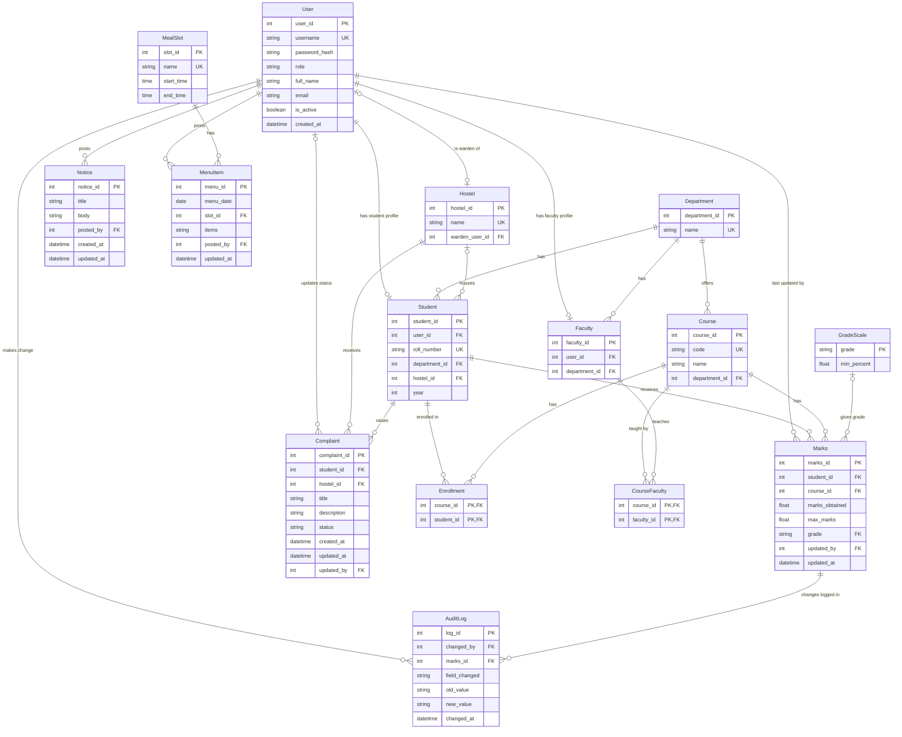

# ER Diagram (MVP)

Version: 1.0
Date: 17 November 2026
Owner: Harsh (System Analyst & Software Architect)

Entity-relationship diagram for the MVP. It is drawn from `docs/analysis/data-dictionary.md` (v1.0), so entity and field names match. Only MVP data is included.

## 1. Diagram

PK = primary key, FK = foreign key, UK = unique. If the diagram does not show in your editor, view the file on GitHub, which draws it automatically.

## 2. Relationships in words

| Relationship | Meaning | SRS |
|---|---|---|
| User and Student, User and Faculty | Every student and faculty member has one login account. Warden, Mess Admin and Admin need only the User row. | FR-1, FR-3 |
| User and Hostel | A hostel has at most one warden and a warden manages one hostel (decision D-2). | FR-14 |
| Student and Hostel | A student belongs to at most one hostel. Day scholars have none. | FR-12 |
| Student, Course, Enrollment | A student can be enrolled in many courses and a course has many students. | FR-31 |
| Faculty, Course, CourseFaculty | A faculty member can teach many courses and a course can have more than one teacher. | FR-31 |
| Marks | One row per student per course. The student must be enrolled and the editor must teach the course. | FR-8, FR-10 |
| Marks and AuditLog | Every change to marks or grade adds an AuditLog row. Rows are never edited or deleted. | FR-11 |
| Student and Complaint | A student raises many complaints and sees only their own. | FR-12, FR-13 |
| Hostel and Complaint | A complaint goes to the hostel of the student who raised it. | FR-14 |
| MealSlot and MenuItem | A menu entry is one dish list for one date and one meal slot. | FR-16, FR-17 |

## 3. Design notes

- User, Student and Faculty are separate tables so login data stays apart from profile data.
- Department, Hostel, GradeScale and MealSlot are configuration tables, so another university can set its own values (NFR-11).
- The weekly menu is not stored. It is the seven daily menus for that week.
- `Complaint.hostel_id` is copied from the student's hostel when the complaint is raised, so old complaints stay with the right hostel even if the student moves.
- `Marks` can only be created for a student and course that exist in `Enrollment`. The database alone cannot enforce this, so the application checks it.

## 4. Change log

| Version | Date | Change | Author |
|---|---|---|---|
| 1.0 | 17 Nov 2026 | Initial ER diagram from data dictionary v1.0 | Harsh |