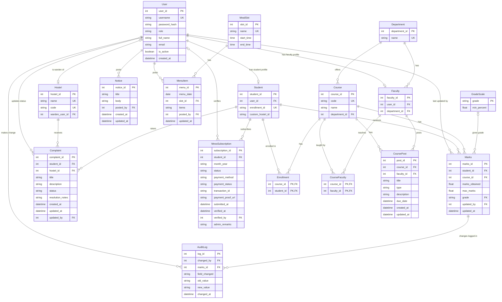

# ER Diagram (MVP)

Version: 1.1
Date: 19 November 2026
Owner: Harsh (System Analyst & Software Architect), updated with Development Team

Entity-relationship diagram for the MVP. It is drawn from `docs/analysis/data-dictionary.md` (v1.1), so entity and field names match. Only MVP data is included.

## 1. Diagram

PK = primary key, FK = foreign key, UK = unique. If the diagram does not show in your editor, view the file on GitHub, which draws it automatically.

## 2. Relationships in words

| Relationship | Meaning | SRS |
|---|---|---|
| User and Student, User and Faculty | Every student and faculty member has one login account. Warden, Mess Admin and Admin need only the User row. | FR-1, FR-3 |
| User and Hostel | A hostel has at most one warden and a warden manages one hostel (decision D-2). | FR-14 |
| Student and Hostel | Resident students have an assigned `custom_hostel_id` (e.g. "BH1-304"). Day scholars have none (null) (decision D-6). | FR-12 |
| Student, Course, Enrollment | A student can be enrolled in many courses and a course has many students. | FR-31 |
| Faculty, Course, CourseFaculty | A faculty member can teach many courses and a course can have more than one teacher. | FR-31 |
| Marks | One row per student per course. The student must be enrolled and the editor must teach the course. | FR-8, FR-10 |
| Marks and AuditLog | Every change to marks or grade adds an AuditLog row. Rows are never edited or deleted. | FR-11 |
| Student and Complaint | A resident student raises complaints and sees only their own. | FR-12, FR-13 |
| Hostel and Complaint | A complaint is mapped to the hostel via the student's `custom_hostel_id` prefix (e.g. "BH1"). | FR-14, FR-15 |
| MealSlot and MenuItem | Three daily meal slots: Breakfast (8:30-10:30), Lunch (12:30-14:30), and Dinner (19:30-21:30). `(menu_date, slot_id)` is unique for Upsert. | FR-16, FR-17 |
| Student and MessSubscription | A student chooses monthly subscription (Subscribe or Opt-Out) with UPI QR proof or manual cash entry. | FR-33, FR-34 |
| Course and CoursePost | Faculty post learning materials, quizzes, lab evaluations, and assignment deadlines for enrolled students. | FR-36 |

## 3. Design notes

- User, Student and Faculty are separate tables so login data stays apart from profile data.
- Students are uniquely identified by `enrollment_id`.
- Department, Hostel, GradeScale and MealSlot are configuration tables, so another university can set its own values (NFR-11).
- The weekly menu is not stored separately; it is queried from the daily menus for that week.
- `Complaint.resolution_notes` stores optional remarks entered by the warden when status moves to Resolved.
- `MessSubscription` tracks both digital payments (UPI QR, UTR, screenshot) and offline cash vouchers recorded by the Mess Admin.
- `CoursePost` allows course instructors to communicate evaluation dates and syllabus instructions scoped strictly to enrolled students.

## 4. Change log

| Version | Date | Change | Author |
|---|---|---|---|
| 1.0 | 17 Nov 2026 | Initial ER diagram from data dictionary v1.0 | Harsh |
| 1.1 | 19 Nov 2026 | Updated Student (enrollment_id, custom_hostel_id); added Complaint.resolution_notes, MessSubscription, and CoursePost | Team |