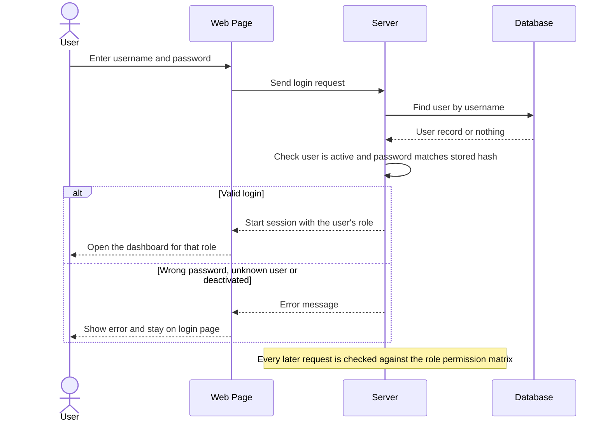
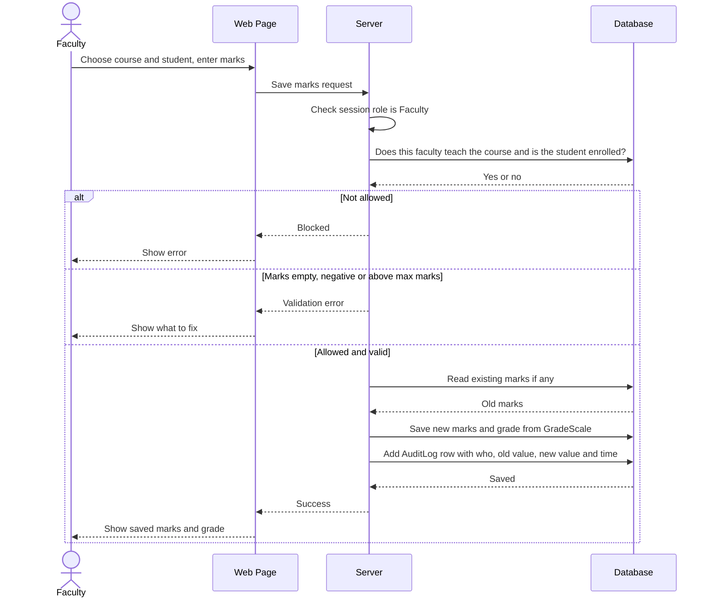
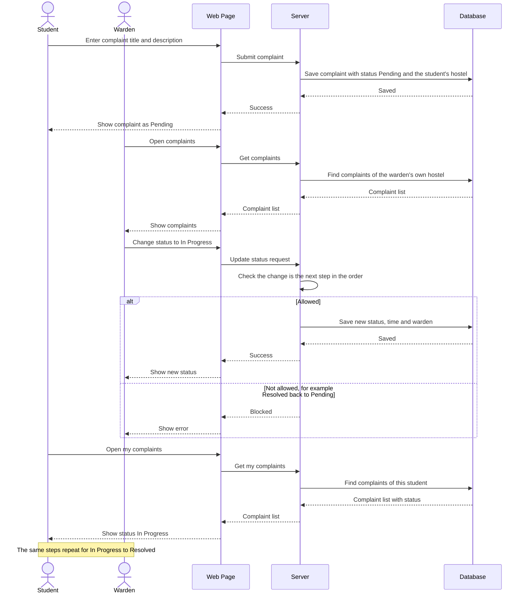

# Sequence Diagrams (MVP)

Version: 1.0
Date: 17 November 2026
Owner: Harsh (System Analyst & Software Architect)

Three sequence diagrams for the key MVP flows. They use the entities in `er-diagram.md` and the rules in `docs/analysis/permission-matrix.md`.

| # | Flow | SRS |
|---|---|---|
| 1 | Login | FR-1, FR-2, FR-18 |
| 2 | Faculty enters marks (with audit log) | FR-8, FR-11 |
| 3 | Hostel complaint from Pending to Resolved | FR-12 to FR-15 |

In all diagrams, "Server" checks the user's role on every request, not just the screen (NFR-3).

## 1. Login

## 2. Faculty enters marks

## 3. Hostel complaint from Pending to Resolved

## 4. Change log

| Version | Date | Change | Author |
|---|---|---|---|
| 1.0 | 17 Nov 2026 | Initial sequence diagrams for login, marks and complaints | Harsh |